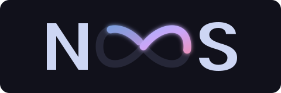
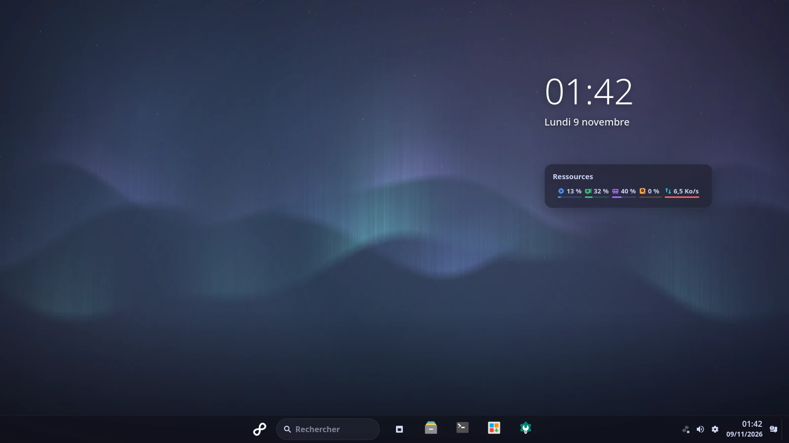
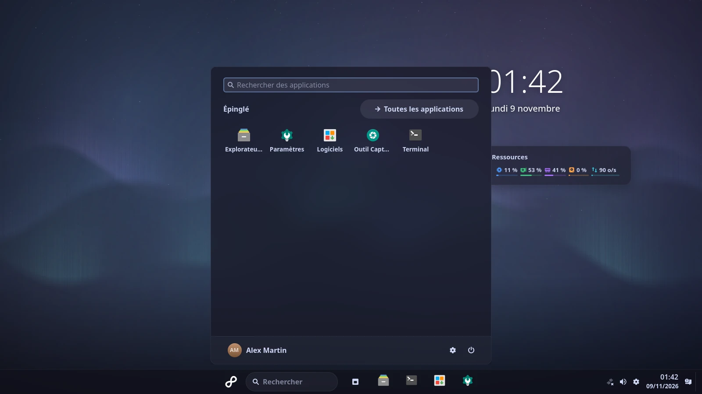
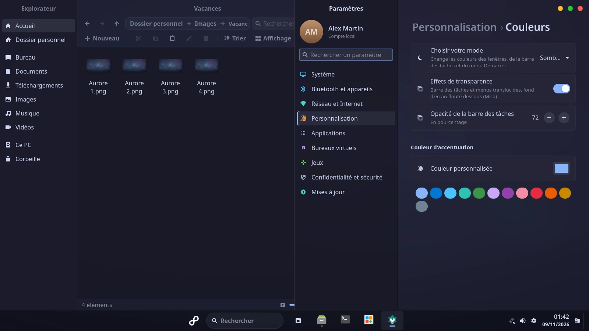
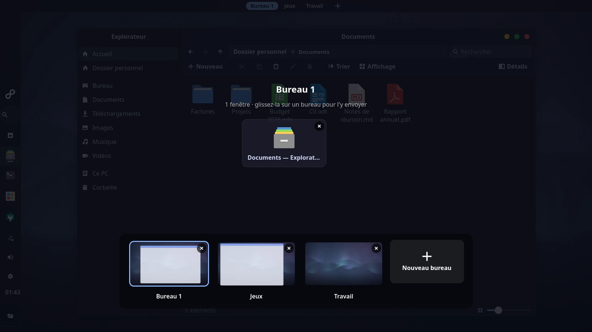
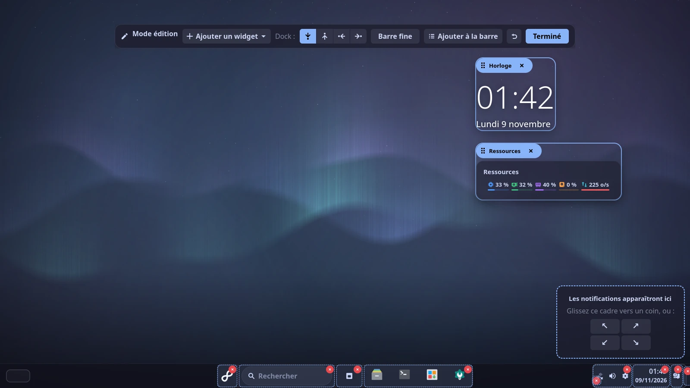
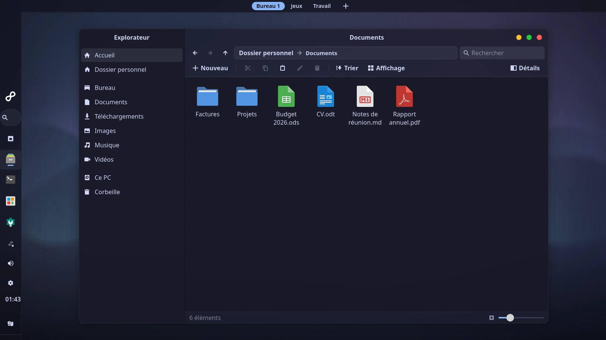
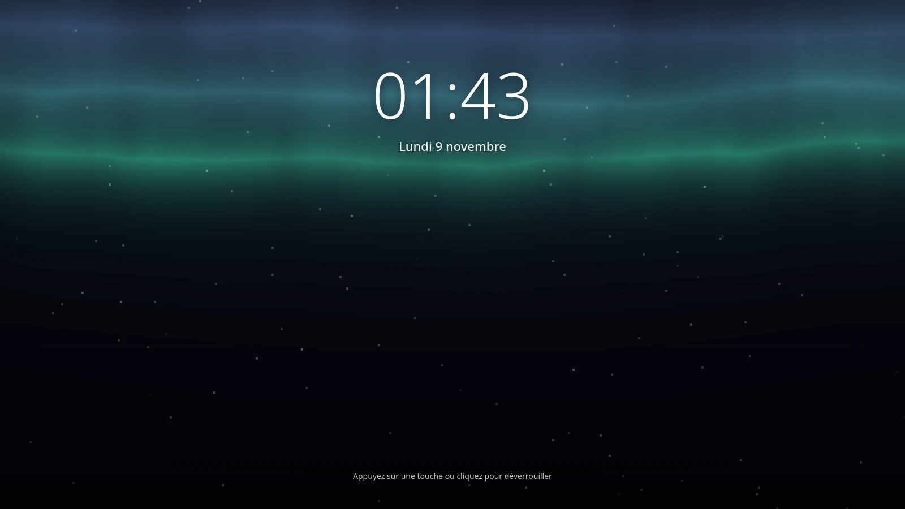
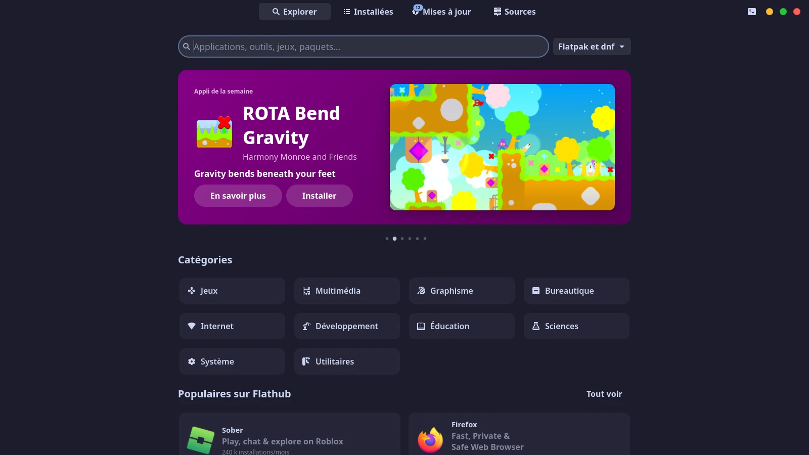
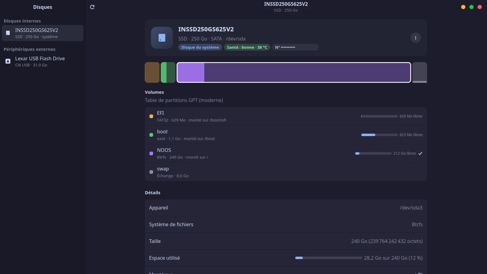

<div align="center">



### Un bureau Linux qui a le confort de Windows 11, la vitesse de Rust et toutes les couleurs que vous voulez.

[](https://www.rust-lang.org/)
[](https://github.com/Smithay/smithay)
[](https://github.com/xapp-project/libadapta)
[](https://copr.fedorainfracloud.org/coprs/chomiam/noos/)
[](LICENSE)
[](#-vibe-codé-et-fier-de-lêtre)



</div>

---

## ✨ NOOS, c'est quoi ?

**NOOS** est un **environnement de bureau complet** pour Linux : le gestionnaire de fenêtres,
la barre des tâches, le menu Démarrer, les notifications, l'écran de connexion, l'écran de
verrouillage… et une vingtaine d'applications maison, de l'Explorateur de fichiers au
gestionnaire de disques.

L'idée est simple : **retrouver ses repères de Windows 11** (barre centrée, menu Démarrer,
ancrage des fenêtres, « Lecture automatique » quand on branche une clé…), sur un système libre,
rapide et pensé pour le jeu. Ensuite, **tout personnaliser** : couleurs, coins, position du
dock, widgets, animations de l'écran de veille.

Tout est écrit en **Rust**, de la première ligne du compositeur jusqu'à la dernière appli.

## 📸 En images

<table>
<tr>
<td width="50%"><br><b>Menu Démarrer</b> : applis épinglées, recherche, compte et alimentation, sur un fond flouté façon Mica.</td>
<td width="50%"><br><b>Explorateur et Paramètres</b> ancrés côte à côte (Super+← / →, ou on glisse la fenêtre contre un bord).</td>
</tr>
<tr>
<td><br><b>Vue des tâches et bureaux virtuels</b> (Super+Tab) : on glisse une fenêtre sur un bureau pour l'y envoyer.</td>
<td><br><b>Mode édition</b> : on déplace les éléments du dock, les widgets et même le coin des notifications.</td>
</tr>
<tr>
<td><br><b>Dock sur le côté</b> et <b>barre fine</b> en haut avec les bureaux virtuels : la disposition, c'est vous qui la choisissez.</td>
<td><br><b>Écran de verrouillage animé</b> (shaders GLSL) : un catalogue d'animations, avec des clins d'œil aux écrans de veille de Windows 95 / 98.</td>
</tr>
<tr>
<td><br><b>Logiciels</b> : la vitrine Flathub et les paquets Fedora au même endroit, avec les mises à jour signalées dans la barre.</td>
<td><br><b>Disques</b> : carte des partitions, santé SMART, formatage (NTFS compris), test de vitesse et montage sans galère de permissions.</td>
</tr>
</table>

<sub>Captures prises dans l'aperçu de NOOS ; fond d'écran « Aurore » généré par
<a href="docs/captures/fond-aurore.py">un petit script</a>.</sub>

## 🎁 Ce qu'il y a dans la boîte

- 🪟 **Un bureau façon Windows 11** : dock centré (ou à gauche, à droite, en haut), menu
  Démarrer, réglages rapides, centre de notifications, ancrage des fenêtres en moitiés, tiers
  et quarts, Alt+Tab, effet de transparence Mica.
- 🎨 **Personnalisation sans limite** : palettes, couleur d'accent, mode clair / sombre, coins,
  CSS libre, appliqués à chaud. **Les applis externes suivent aussi** (GTK3, GTK4, Qt).
- 🧩 **Mode édition** : on réorganise le dock, on retire ou on ajoute des éléments, on pose des
  widgets sur le bureau (horloge, ressources, note, calendrier).
- 🖥️ **Bureaux virtuels et plusieurs écrans** : vue des tâches, glissement animé, écran
  principal, disposition des moniteurs à la souris.
- 🎮 **Pensé pour le jeu** : VRR, affichage direct en plein écran, 10 bits, détection HDR,
  profils d'alimentation (en cours de validation sur du vrai matériel).
- 📂 **Des applis maison** : Explorateur, Paramètres, Logiciels, Terminal, Éditeur de texte,
  Photos, Archives, Disques, Capture d'écran, Porte-clés, Sauvegarder et Restaurer
  (instantanés Btrfs avant chaque mise à jour, restauration depuis le menu de démarrage).
- 🔒 **Du démarrage à la session** : thème GRUB, Plymouth, écran de connexion, écran de
  verrouillage animé, fenêtre « Contrôle de compte » pour les mots de passe administrateur.
- 💿 **Un installateur** : ISO live Fedora 45, partitionnement Btrfs, compte, fuseau horaire,
  le tout en plein écran.

Le détail de chaque appli est dans le [guide détaillé](docs/GUIDE.md).

## 🦀 Pourquoi Rust et Smithay ?

Le cœur d'un bureau Wayland, c'est le **compositeur** : il dessine chaque image, reçoit chaque
mouvement de souris et chaque touche. S'il plante, toute la session tombe. S'il hésite, tout
saccade.

- **Rust**, c'est la vitesse du C sans ses pièges mémoire : pas de pointeur fou, pas de
  ramasse-miettes qui fige l'écran au mauvais moment, et le compilateur refuse les accès
  concurrents dangereux. Les erreurs que les autres bureaux découvrent en production, on les
  attrape **à la compilation**.
- **[Smithay](https://github.com/Smithay/smithay)** fournit les briques Wayland en Rust (écran
  et GPU via DRM/KMS, clavier et souris via libinput, des dizaines de protocoles). On assemble
  **notre** compositeur au lieu de dépendre d'un autre bureau. Ça laisse la main sur ce qui
  compte pour le jeu (VRR, affichage direct, 10 bits) et sur le comportement des fenêtres.
- **Un seul langage partout** : compositeur, shell et applis partagent le même code de
  configuration et le même protocole. Un réglage de Paramètres s'applique dans la seconde,
  partout.
- **Léger** : pas de moteur JavaScript ni de machine virtuelle. On compile en natif, avec LTO.

## 🎨 Pourquoi libAdapta plutôt que libadwaita ?

Les applis GNOME modernes utilisent **libadwaita**, superbe mais **verrouillée** : sa feuille
de style est figée dans la bibliothèque, et changer son apparence n'est pas prévu. C'est un
choix assumé de GNOME, mais pas le nôtre.

**[libAdapta](https://github.com/xapp-project/libadapta)** est le fork « doux » de libadwaita
maintenu par l'équipe de **Linux Mint** :

| | libadwaita | libAdapta |
|---|---|---|
| API et widgets | ✅ | ✅ identiques (libadwaita 1.5) |
| Rendu par défaut | Adwaita | Adwaita, au pixel près |
| **Chargement de thèmes** | ❌ | ✅ `~/.local/share/themes/<thème>/libadapta-1.5/` |
| Couleurs, coins, boutons, CSS | limité à l'accent | **tout** |

NOOS génère donc un **vrai thème libAdapta** à partir de vos choix (palette, accent, coins,
boutons de fenêtre façon Windows 11, CSS personnalisé) et le recharge à chaud dans toutes les
applis de la session. Le même travail est fait pour **GTK3** (adw-gtk3), **libadwaita** (accent
et variables CSS) et **Qt 5 / 6** (palette qt6ct, barre de titre qui suit la disposition des
boutons).

Seule contrepartie : libAdapta suit l'API de libadwaita 1.5, donc les tout derniers widgets
GNOME arrivent un peu plus tard.

## 🚀 Essayer NOOS

Sur **Fedora 45** (Workstation ou autre variante dnf) :

```bash
sudo dnf copr enable chomiam/noos
```

```bash
sudo dnf install noos
```

Déconnectez-vous, choisissez **NOOS** dans la liste des sessions, et c'est parti. Le paquet
est reconstruit sur [COPR](https://copr.fedorainfracloud.org/coprs/chomiam/noos/) à chaque
nouveauté, et Logiciels vous prévient des mises à jour.

Pour une installation complète (écran de connexion, Plymouth, GRUB, Btrfs + instantanés),
construisez l'**ISO** avec `./noos-iso/build.sh`. Pour développer, voyez le
[guide détaillé](docs/GUIDE.md#environnement-de-développement-fedora-silverblue).

> ⚠️ **NOOS est un prototype.** On l'utilise au quotidien, mais attendez-vous à des bugs, et
> testez d'abord dans une machine virtuelle si vous tenez à votre configuration.

## 🗺️ Les prochains chantiers

| | Chantier | L'idée |
|---|---|---|
| 🎮 | **Session Steam / Gamescope** | Une session dédiée au jeu, lancée depuis l'écran de connexion : Steam en mode Big Picture dans Gamescope, VRR et HDR, retour au bureau en un clic. Comme une console, sur votre PC. |
| 📺 | **Session multimédia (HTPC)** | Le PC du salon : interface plein écran lisible à 3 mètres, pilotable à la manette ou à la télécommande, films, musique, photos et streaming. |
| 💾 | **Flasheur de clés USB** | Une appli pour créer des clés de démarrage, avec encore plus de fonctions que Rufus : ISO Windows et Linux, plusieurs ISO sur une même clé, persistance, vérification des sommes de contrôle, téléchargement des ISO intégré, image d'une clé → fichier, test des secteurs défectueux. |
| 🖌️ | **Bibliothèque de thèmes** | Des thèmes complets pour NOOS (palette, fond d'écran, animation de verrouillage, icônes) à parcourir, essayer en un clic et partager. |
| 🧩 | **Encore plus de widgets** | Météo, lecteur multimédia, calendrier enrichi, photos, raccourcis… sur le bureau comme dans la barre. |
| 🐛 | **Correctifs et finitions** | Stabilité sur du vrai matériel (multi-écrans, VRR, HDR), performances, et chaque bug remonté. |

## 🤖 Vibe codé, et fier de l'être

NOOS est **entièrement vibe codé** : le code est écrit par **Claude (Opus 5.5)** dans
**l'application Claude pour ordinateur**, au fil d'une conversation en français avec Axel. Axel
décrit ce qu'il veut (« une appli de disques qui m'impressionne », « le dock sur les côtés »,
« la souris freeze toutes les 3 secondes »…). Claude écrit le code, compile, teste dans un
aperçu imbriqué, fait des captures pour vérifier, publie sur GitHub et lance le paquet COPR.

Ce que ça donne :

- **≈ 58 000 lignes de Rust** réparties en **27 composants**, du compositeur à l'installateur ;
- un humain qui garde la main sur **la vision, les priorités et les tests sur sa vraie
  machine** ;
- une mémoire partagée dans [`CLAUDE.md`](CLAUDE.md) : préférences, règles de sécurité,
  pièges déjà rencontrés et outils de test, pour que chaque session reprenne là où la
  précédente s'est arrêtée.

C'est une expérience autant qu'un bureau : jusqu'où peut-on aller quand on décrit ce qu'on veut
plutôt que de tout taper soi-même ? Les retours, issues et idées sont les bienvenus.

## 📚 Pour aller plus loin

- [Guide détaillé](docs/GUIDE.md) : chaque composant, configuration `noos.toml`, raccourcis,
  ISO, développement.
- [CLAUDE.md](CLAUDE.md) : notes de travail, outils d'aperçu et variables de test.

## ⚖️ Licences

NOOS est sous **GPL-3.0-or-later**. Composants tiers :
- `third_party/libadapta` : LGPL-2.1-or-later ;
- `noos-adapta/` : dérivé de libadwaita-rs (MIT) ;
- code adapté de l'exemple « smallvil » de Smithay : MIT.
